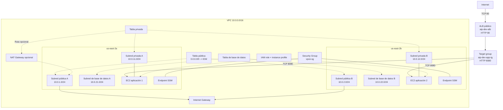
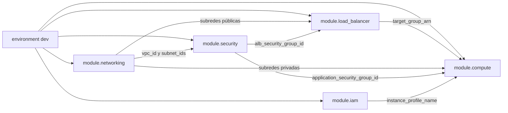

# Documentación técnica de infraestructura AWS

## Alcance

Este documento describe la plataforma definida en Terraform para el entorno `dev`. La implementación incluye:

- Una VPC con seis subredes distribuidas en dos zonas de disponibilidad.
- Tablas de rutas públicas, privadas y de base de datos.
- Un Internet Gateway y un NAT Gateway opcional.
- Un Application Load Balancer (ALB) público.
- Dos instancias EC2 privadas conectadas al target group del ALB.
- Grupos de seguridad separados para ALB, aplicación y base de datos.
- Un rol IAM y un instance profile para que las instancias usen AWS Systems Manager.
- Un endpoint privado de SSM para comunicación dentro de la VPC.
- Una AMI base creada con Packer y Ansible.

La aplicación todavía no está instalada en las instancias de cómputo: el despliegue actual crea las máquinas y las registra en el target group, pero el Packer/Ansible actual solo prepara Amazon Linux 2023 con herramientas básicas.

## Arquitectura AWS



## Composición de Terraform

El entorno raíz [`environments/dev/main.tf`](../environments/dev/main.tf) instancia cinco módulos:

| Módulo | Responsabilidad |
|---|---|
| `networking` | VPC, subredes, tablas de rutas, Internet Gateway, NAT Gateway y endpoint SSM. |
| `security` | Security Groups del ALB, aplicación y base de datos. |
| `load-balancer` | ALB público, target group y listener HTTP. |
| `iam` | Rol IAM EC2, instance profile y política administrada de SSM. |
| `compute` | Dos instancias EC2 privadas y sus registros en el target group. |



## Redes y subredes

La VPC usa `10.0.0.0/16` por defecto y habilita DNS interno y nombres DNS.

| Capa | A | B | Tabla de rutas |
|---|---|---|---|
| Pública | `10.0.1.0/24`, `us-east-2a` | `10.0.2.0/24`, `us-east-2b` | Pública: `0.0.0.0/0` hacia el Internet Gateway |
| Privada | `10.0.11.0/24`, `us-east-2a` | `10.0.12.0/24`, `us-east-2b` | Privada: solo ruta local por defecto; ruta NAT opcional |
| Base de datos | `10.0.21.0/24`, `us-east-2a` | `10.0.22.0/24`, `us-east-2b` | Base de datos: solo ruta local por defecto |

Las subredes públicas asignan automáticamente IP públicas. Las subredes privadas y de base de datos no lo hacen.

Los rangos se calculan con `cidrsubnet(var.vpc_cidr, 8, índice)`. Los valores anteriores corresponden al CIDR predeterminado `10.0.0.0/16`.

### NAT Gateway

`enable_nat_gateway` controla tres recursos:

- Una Elastic IP.
- Un NAT Gateway en la subred pública A.
- Una ruta `0.0.0.0/0` desde la tabla privada al NAT Gateway.

Su valor predeterminado es `false`, por lo que las subredes privadas no tienen salida a Internet directamente. Activarlo puede generar cargos adicionales en AWS. La tabla de rutas de base de datos no recibe una ruta NAT.

### Endpoint privado de SSM

El módulo de red crea un endpoint de tipo Interface para `com.amazonaws.us-east-2.ssm` en las dos subredes privadas. Usa el Security Group `aws-infrastructure-platform-dev-vpce-sg`, que permite HTTPS TCP 443 desde el CIDR de la VPC.

La configuración habilita DNS privado y coloca el endpoint en ambas zonas de disponibilidad. Junto con la política `AmazonSSMManagedInstanceCore` y el instance profile asociado a EC2, proporciona conectividad privada hacia la API regional de SSM sin necesidad de IP pública. Para habilitar todas las funciones de Session Manager, el diseño requeriría además los endpoints privados `ssmmessages` y `ec2messages`.

## Cómputo

El módulo `compute` crea una instancia por cada elemento recibido en `subnet_ids`. El entorno pasa las dos subredes privadas, por lo que despliega dos instancias:

- `aws-infrastructure-platform-dev-app-1` en `private-a`.
- `aws-infrastructure-platform-dev-app-2` en `private-b`.

Las propiedades principales son:

| Propiedad | Valor predeterminado/configuración |
|---|---|
| AMI | `ami_id` obligatorio; `terraform.tfvars` usa `ami-0ae8039caa83aca94` |
| Tipo de instancia | `t3.micro` |
| IP pública | Deshabilitada |
| Security Group | Grupo de aplicación |
| IAM | Instance profile del módulo IAM |
| Target group | `aip-dev-app-tg`, puerto `8080` |

Las instancias se registran automáticamente en el target group como targets de tipo `instance`. El listener envía tráfico al puerto 8080, pero no hay todavía una aplicación en ejecución que responda a los health checks HTTP definidos en `/`.

## IAM

El módulo `iam` crea:

- Un rol IAM EC2 cuyo principal confiable es `ec2.amazonaws.com`.
- Un instance profile con el rol asociado.
- Una asociación de la política administrada `AmazonSSMManagedInstanceCore`.

El nombre del rol es `aws-infrastructure-platform-dev-ec2-role` y el instance profile es `aws-infrastructure-platform-dev-ec2-profile`.

## Balanceador de carga

El ALB `aip-dev-alb` es internet-facing y se despliega en las dos subredes públicas.

| Recurso | Configuración |
|---|---|
| ALB | Público, Application Load Balancer, Security Group del ALB |
| Listener | HTTP en el puerto 80 |
| Target group | `aip-dev-app-tg`, HTTP puerto 8080, targets EC2 |
| Health check | HTTP `/`, código válido `200`, intervalo 30 segundos |

El listener reenvía el tráfico al target group. La cuenta actual tiene dos instancias EC2 privadas registradas como targets.

## Grupos de seguridad

| Grupo | Ingreso | Egreso |
|---|---|---|
| ALB | TCP 80 y 443 desde `0.0.0.0/0` | TCP 8080 hacia el Security Group de aplicación |
| Aplicación | TCP 8080 desde el Security Group del ALB | Todo tráfico hacia cualquier destino |
| Base de datos | TCP 5432 desde el Security Group de aplicación | Sin reglas explícitas; las respuestas están permitidas por el comportamiento stateful |
| VPC endpoints | TCP 443 desde el CIDR de la VPC | Todo tráfico |

Los puertos predeterminados son `application_port = 8080` y `database_port = 5432`.

El Security Group de aplicación no está limitado a una subred o a una instancia concreta, sino a la identidad del Security Group del ALB para tráfico entrante. No se ha desplegado ninguna instancia de base de datos; el Security Group de base de datos queda preparado para esa futura capa.

## Flujo de tráfico

1. Un cliente accede al DNS del ALB público por HTTP en el puerto 80.
2. El listener del ALB reenvía la solicitud al target group `aip-dev-app-tg`.
3. El target group intenta enviar la solicitud a cada EC2 privada por el puerto 8080.
4. Las instancias usan su Security Group de aplicación y no tienen dirección pública.
5. El role/instance profile permite que EC2 use la API de SSM.
6. El endpoint privado SSM en las subredes privadas permite comunicación privada con el servicio SSM cuando el NAT está deshabilitado.
7. Si `enable_nat_gateway = true`, las subredes privadas pueden iniciar conexiones IPv4 hacia Internet a través del NAT Gateway.

## Variables del entorno

Los valores predeterminados definidos en [`environments/dev/variables.tf`](../environments/dev/variables.tf) son:

| Variable | Predeterminado |
|---|---|
| `aws_region` | `us-east-2` |
| `aws_profile` | `aws-real` |
| `environment` | `dev` |
| `project_name` | `aws-infrastructure-platform` |
| `vpc_cidr` | `10.0.0.0/16` |
| `enable_nat_gateway` | `false` |
| `instance_type` | `t3.micro` |
| `ami_id` | Sin valor predeterminado; debe configurarse |

[`environments/dev/terraform.tfvars`](../environments/dev/terraform.tfvars) establece `enable_nat_gateway = false`, `ami-0ae8039caa83aca94` y `t3.micro`.

## Packer y Ansible

La plantilla [`packer/amazon-linux-2023/packer.pkr.hcl`](../packer/amazon-linux-2023/packer.pkr.hcl) construye una AMI Amazon Linux 2023:

- Busca la AMI base oficial Amazon Linux 2023 más reciente.
- Utiliza `us-east-2`.
- Usa una VPC, subred pública y Security Group temporal definidos en la plantilla.
- Solicita una IP pública para construir la imagen temporal.
- Ejecuta el playbook [`ansible/playbooks/base.yml`](../ansible/playbooks/base.yml).

El playbook actual actualiza todos los paquetes y instala `git`, `curl-minimal` y `unzip`.

El resultado se registra en [`packer/amazon-linux-2023/manifest.json`](../packer/amazon-linux-2023/manifest.json). La AMI registrada en el entorno actual es `ami-0ae8039caa83aca94`.

Las operaciones de Packer dependen de valores puntuales de infraestructura temporal; antes de reconstruir la AMI, revisa el VPC ID, subnet ID y rango CIDR autorizado para SSH en la plantilla.

## Outputs del entorno

[`environments/dev/outputs.tf`](../environments/dev/outputs.tf) expone:

- Identidad y ARN del llamador AWS.
- Región efectiva.
- Zonas de disponibilidad disponibles.
- Etiquetas comunes.
- ID y CIDR de la VPC.
- ID de la tabla de rutas principal.

## Validación y despliegue

Ejecutar desde el entorno `dev`:

```powershell
cd environments/dev
terraform init
terraform validate
terraform plan
terraform apply
```

Para probar cambios en una sola capacidad, usar los comandos normales de Terraform sobre el entorno completo.

Antes de aplicar, verificar:

- Que el perfil AWS `aws-real` existe y tiene permisos suficientes.
- Que `ami_id` corresponde a una AMI válida en `us-east-2`.
- Que el CIDR no entra en conflicto con redes existentes.
- Si se habilita el NAT Gateway, que se aceptan sus cargos adicionales.
- Que el puerto 8080 tiene un servicio real si se requiere que los targets estén `healthy`.

## Archivos de referencia

- [`environments/dev/main.tf`](../environments/dev/main.tf): composición del entorno.
- [`environments/dev/providers.tf`](../environments/dev/providers.tf): proveedor AWS y configuración regional.
- [`environments/dev/variables.tf`](../environments/dev/variables.tf): variables del entorno.
- [`modules/networking/main.tf`](../modules/networking/main.tf): VPC, Internet Gateway y tablas de rutas.
- [`modules/networking/subnets.tf`](../modules/networking/subnets.tf): seis subredes y asociaciones.
- [`modules/networking/nat.tf`](../modules/networking/nat.tf): NAT Gateway opcional.
- [`modules/networking/endpoints.tf`](../modules/networking/endpoints.tf): endpoint privado SSM.
- [`modules/security/main.tf`](../modules/security/main.tf): Security Groups.
- [`modules/load-balancer/main.tf`](../modules/load-balancer/main.tf): ALB, target group y listener.
- [`modules/iam/main.tf`](../modules/iam/main.tf): rol e instance profile EC2.
- [`modules/compute/main.tf`](../modules/compute/main.tf): instancias EC2 y registros en el target group.
- [`design_considerations.txt`](./design_considerations.txt): consideraciones de diseño.
- [`subnet_map.txt`](./subnet_map.txt): resumen de las subredes.
