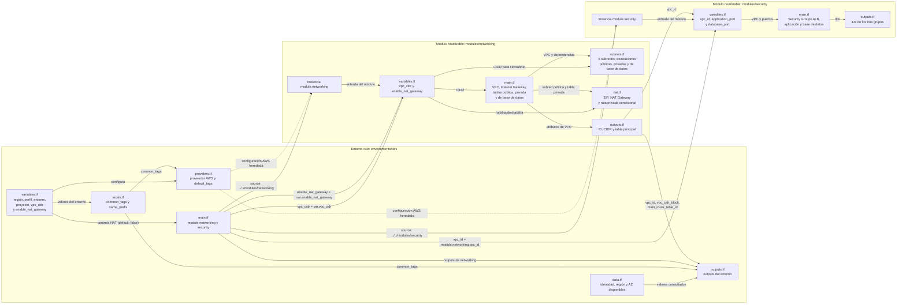
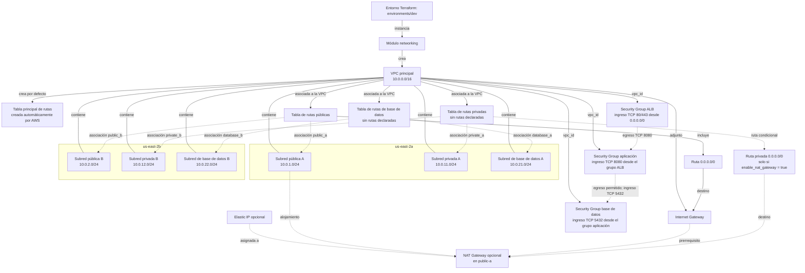

# Documentación técnica de infraestructura AWS

## Alcance

Este documento describe la configuración Terraform del entorno `dev` y los módulos que instancia: `networking` y `security`. La infraestructura incluye una VPC con seis subredes, tablas de rutas, grupos de seguridad y un NAT Gateway opcional, deshabilitado por defecto. No declara un Application Load Balancer (ALB), instancias, servicios de aplicación, bases de datos ni endpoints: los grupos de seguridad definen reglas para esos componentes, pero no los crean.

## Componentes de Terraform

El entorno raíz configura el proveedor y sus datos de contexto, y llama a los módulos `networking` y `security`. El módulo de red usa `vpc_cidr` para crear la VPC y expone outputs que el entorno raíz vuelve a publicar. El módulo de seguridad recibe el ID de esa VPC y crea grupos para el ALB, la aplicación y la base de datos.



## Arquitectura AWS



Ambas asociaciones públicas están declaradas en `subnets.tf` y utilizan los IDs de las subredes correspondientes. La tabla pública envía la ruta predeterminada al Internet Gateway.
Los componentes NAT del diagrama son condicionales: solo se crean cuando `enable_nat_gateway = true`.
Las relaciones entre Security Groups representan reglas de filtrado, no recursos de aplicación desplegados: todavía no hay un ALB, instancias ni una base de datos asociados a ellos.

## Recursos y relaciones

| Recurso | Configuración | Relación y función |
|---|---|---|
| VPC `aws_vpc.main` | `10.0.0.0/16`; compatibilidad DNS y nombres DNS habilitados | Contenedor de las seis subredes; es la VPC a la que se adjunta el Internet Gateway y a la que pertenece la tabla pública. |
| Internet Gateway `aws_internet_gateway.main` | Asociado a la VPC principal | Proporciona el destino para tráfico IPv4 hacia Internet cuando una tabla de rutas asociada tiene una ruta a este gateway. |
| Tabla principal de rutas | Creada automáticamente al crear la VPC; su ID se expone como output | Se aplica por defecto a las subredes que no tienen una asociación explícita. El módulo no agrega una ruta de Internet a esta tabla. |
| Tabla `aws_route_table.public` | Tabla adicional asociada a la VPC | Contiene la ruta por defecto para tráfico IPv4; está asociada explícitamente a las dos subredes públicas. |
| Tabla `aws_route_table.private` | Tabla adicional asociada a la VPC; etiqueta `Name = "aws-infrastructure-platform-private-dev-rt"` y tier `private` | Está asociada explícitamente a `private-a` y `private-b`. No tiene rutas declaradas aparte de la ruta local implícita de la VPC; no proporciona salida a Internet. |
| Tabla `aws_route_table.database` | Tabla adicional asociada a la VPC; etiqueta `Name = "aws-infrastructure-platform-database-dev-rt"` y tier `database` | Está asociada explícitamente a `database-a` y `database-b`. No tiene rutas declaradas aparte de la ruta local implícita de la VPC; no proporciona salida a Internet. |
| Ruta `aws_route.public_internet` | Destino `0.0.0.0/0`, gateway de destino `aws_internet_gateway.main` | Envía el tráfico IPv4 que no coincide con rutas más específicas al Internet Gateway. |
| Elastic IP `aws_eip.nat` | Un recurso condicional; `domain = "vpc"` | Se reserva para el NAT Gateway cuando `enable_nat_gateway = true`. |
| NAT Gateway `aws_nat_gateway.main` | Un recurso condicional ubicado en `public-a`; depende del Internet Gateway | Usa la Elastic IP y permite que las subredes privadas inicien conexiones hacia destinos externos, sin asignarles direcciones públicas. No acepta conexiones entrantes no solicitadas desde Internet. |
| Ruta `aws_route.private_nat` | Destino `0.0.0.0/0` en `aws_route_table.private`; condicional | Cuando se habilita el NAT Gateway, envía el tráfico saliente de ambas subredes privadas hacia ese gateway. No cambia la tabla de rutas de base de datos. |
| Subredes públicas A y B | `10.0.1.0/24` en `us-east-2a`; `10.0.2.0/24` en `us-east-2b`; asignación automática de IP pública habilitada | Asociadas a la tabla pública, que enruta `0.0.0.0/0` al Internet Gateway. Segmentos previstos para recursos públicos, como balanceadores. |
| Subredes privadas A y B | `10.0.11.0/24` en `us-east-2a`; `10.0.12.0/24` en `us-east-2b`; asignación automática de IP pública deshabilitada | Segmentos previstos para cargas de aplicación. Ambas usan la tabla privada; obtienen salida a través del NAT Gateway solo si se habilita la variable correspondiente. |
| Subredes de base de datos A y B | `10.0.21.0/24` en `us-east-2a`; `10.0.22.0/24` en `us-east-2b`; asignación automática de IP pública deshabilitada | Segmentos previstos para datos. Ambas están asociadas a la tabla de base de datos. No se declaran recursos de base de datos. |

## Grupos de seguridad

El módulo `security` crea tres Security Groups dentro de la VPC. Las reglas usan referencias entre grupos para limitar el tráfico entre capas; crear estas reglas no crea ni asocia un ALB, servidores o una base de datos.

| Grupo | Ingreso permitido | Egreso configurado |
|---|---|---|
| `aws_security_group.alb` | TCP 80 y 443 desde `0.0.0.0/0` | TCP en `application_port` hacia el Security Group de aplicación |
| `aws_security_group.application` | TCP en `application_port` desde el Security Group del ALB | Cualquier protocolo y destino IPv4 (`0.0.0.0/0`) |
| `aws_security_group.database` | TCP en `database_port` desde el Security Group de aplicación | Ninguno declarado; las respuestas al tráfico permitido se admiten por el carácter stateful de los Security Groups de AWS |

Los valores predeterminados del módulo son `application_port = 8080` y `database_port = 5432` (PostgreSQL). El módulo exporta los IDs de los tres grupos, pero `environments/dev/outputs.tf` todavía no los vuelve a publicar como outputs del entorno.

Las subredes se crean con `cidrsubnet(var.vpc_cidr, 8, índice)`, por lo que sus rangos se derivan del CIDR configurable de la VPC. Los rangos de la tabla corresponden al valor predeterminado `10.0.0.0/16`.

## Flujo de tráfico

1. Los recursos dentro de la VPC se comunican mediante las rutas locales de la VPC.
2. Para que una subred tenga salida IPv4 a Internet a través del gateway, su tabla de rutas efectiva debe incluir `0.0.0.0/0` hacia el Internet Gateway.
3. La tabla `aws_route_table.public` incluye `0.0.0.0/0` hacia el Internet Gateway y está asociada a `public-a` y `public-b`. Esas subredes también habilitan la asignación automática de direcciones IPv4 públicas.
4. `private-a` y `private-b` están asociadas a `aws_route_table.private`. Si `enable_nat_gateway = false` (valor predeterminado), la tabla no tiene ruta de salida a Internet aparte de la ruta local implícita. Si se establece en `true`, se crean una Elastic IP, un NAT Gateway en `public-a` y una ruta `0.0.0.0/0` desde la tabla privada al NAT Gateway. Las subredes de base de datos usan una tabla separada sin una ruta NAT.
5. La asignación automática de IP pública no crea rutas; el acceso a Internet de las subredes públicas depende de la asociación con la tabla que enruta al Internet Gateway.

## Módulo y entorno

- `environments/dev` configura el proveedor AWS para `us-east-2` y el perfil CLI `aws-real` por defecto, llama a `modules/networking` con `vpc_cidr` y a `modules/security` con el ID de la VPC creada por networking.
- El módulo de red exporta el ID de la VPC, su CIDR y el ID de la tabla de rutas principal. El entorno vuelve a exponer esos valores.
- El módulo de seguridad recibe `vpc_id` y define `application_port` (8080) y `database_port` (5432) con valores predeterminados; el entorno no los sobrescribe.
- El entorno también consulta la identidad de la cuenta, la región efectiva y las zonas de disponibilidad disponibles, y expone esas consultas como outputs.
- Las etiquetas comunes del entorno son `Project`, `Environment` y `ManagedBy`. Los recursos de red también definen etiquetas propias, incluyendo `Name` y `Tier`.
- El módulo valida que `vpc_cidr` sea un bloque CIDR IPv4 válido. Los valores del entorno se definen en `environments/dev/variables.tf`.
- Los valores predeterminados son región `us-east-2`, perfil `aws-real`, entorno `dev`, proyecto `aws-infrastructure-platform`, CIDR `10.0.0.0/16` y `enable_nat_gateway = false`. `environments/dev/terraform.tfvars` también establece `enable_nat_gateway = false`.
- `enable_nat_gateway` se pasa del entorno al módulo y controla la creación del NAT Gateway, la Elastic IP y la ruta para la tabla privada. Activarlo puede generar cargos adicionales de AWS.
- Las zonas de disponibilidad de las subredes están fijadas en el módulo a `us-east-2a` y `us-east-2b`; cambiar la región del proveedor requiere revisar esas zonas.
- `modules/load-balancer` es actualmente un directorio vacío, no contiene recursos o variables Terraform y no se instancia desde el entorno.

## Archivos de referencia

- [Entorno dev](../environments/dev/main.tf): composición del entorno.
- [Proveedor AWS](../environments/dev/providers.tf): versión de Terraform/proveedor, región y perfil.
- [Variables](../environments/dev/variables.tf): parámetros configurables del entorno.
- [Módulo de red](../modules/networking/main.tf): VPC, Internet Gateway y tablas de rutas pública, privada y de base de datos.
- [Módulo de seguridad](../modules/security/main.tf): Security Groups y reglas de ingreso y egreso para ALB, aplicación y base de datos.
- [Variables de seguridad](../modules/security/variables.tf): VPC y puertos configurables del módulo de seguridad.
- [Outputs de seguridad](../modules/security/outputs.tf): IDs de los Security Groups.
- [NAT Gateway](../modules/networking/nat.tf): Elastic IP, NAT Gateway y ruta de salida condicional para subredes privadas.
- [Subredes](../modules/networking/subnets.tf): rangos, zonas de disponibilidad y asociaciones de las subredes públicas, privadas y de base de datos a sus tablas de rutas.
- [Consideraciones de diseño](./design_considerations.txt): propósito previsto de las capas de subredes.
- [Mapa de subredes](./subnet_map.txt): resumen de CIDR y uso previsto.

## Validación antes del despliegue

Antes de aplicar cambios, ejecutar desde `environments/dev`:

```shell
terraform init
terraform validate
terraform plan
```

Las subredes públicas A y B están asociadas a la tabla pública, las subredes privadas A y B a la tabla privada, y las subredes de base de datos A y B a la tabla de base de datos. Con la configuración predeterminada, NAT está deshabilitado y las subredes privadas no tienen ruta de salida a Internet. Para habilitarla, configura `enable_nat_gateway = true`; las subredes de base de datos permanecen sin una ruta NAT.
