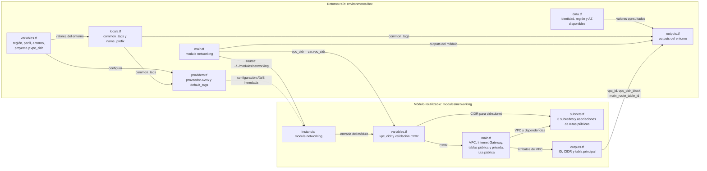
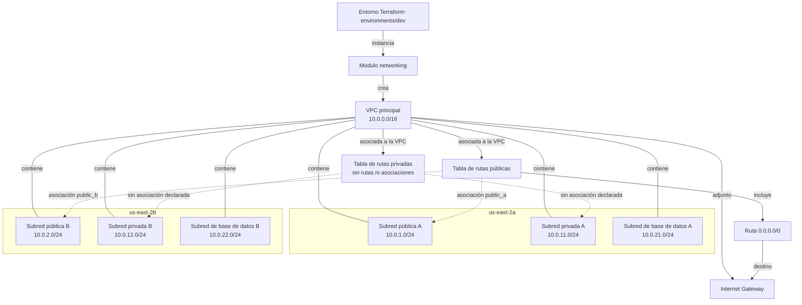

# Documentación técnica de infraestructura AWS

## Alcance

Este documento describe la configuración Terraform del entorno `dev` y el módulo de red que este instancia. La infraestructura definida actualmente es una base de red; no declara balanceadores de carga, instancias, servicios de aplicación, bases de datos, grupos de seguridad, NAT Gateways ni endpoints.

## Componentes de Terraform

El entorno raíz configura el proveedor y sus datos de contexto, y llama al módulo `networking`. El módulo usa `vpc_cidr` para crear la red y expone outputs que el entorno raíz vuelve a publicar.



## Arquitectura AWS



Ambas asociaciones públicas están declaradas en `subnets.tf` y utilizan los IDs de las subredes correspondientes. La tabla pública envía la ruta predeterminada al Internet Gateway.

## Recursos y relaciones

| Recurso | Configuración | Relación y función |
|---|---|---|
| VPC `aws_vpc.main` | `10.0.0.0/16`; compatibilidad DNS y nombres DNS habilitados | Contenedor de las seis subredes; es la VPC a la que se adjunta el Internet Gateway y a la que pertenece la tabla pública. |
| Internet Gateway `aws_internet_gateway.main` | Asociado a la VPC principal | Proporciona el destino para tráfico IPv4 hacia Internet cuando una tabla de rutas asociada tiene una ruta a este gateway. |
| Tabla `aws_route_table.public` | Tabla adicional asociada a la VPC | Contiene la ruta por defecto para tráfico IPv4; está asociada explícitamente a las dos subredes públicas. |
| Tabla `aws_route_table.private` | Tabla adicional asociada a la VPC; etiqueta `Name = "aws-infrastructure-"` | Está creada, pero el módulo no declara rutas ni asociaciones con subredes. Por tanto, las subredes privadas no la utilizan actualmente. |
| Ruta `aws_route.public_internet` | Destino `0.0.0.0/0`, gateway de destino `aws_internet_gateway.main` | Envía el tráfico IPv4 que no coincide con rutas más específicas al Internet Gateway. |
| Subredes públicas A y B | `10.0.1.0/24` en `us-east-2a`; `10.0.2.0/24` en `us-east-2b`; asignación automática de IP pública habilitada | Asociadas a la tabla pública, que enruta `0.0.0.0/0` al Internet Gateway. Segmentos previstos para recursos públicos, como balanceadores. |
| Subredes privadas A y B | `10.0.11.0/24` en `us-east-2a`; `10.0.12.0/24` en `us-east-2b`; asignación automática de IP pública deshabilitada | Segmentos previstos para cargas de aplicación. No se declaran asociaciones de tabla de rutas privadas ni NAT Gateway. |
| Subredes de base de datos A y B | `10.0.21.0/24` en `us-east-2a`; `10.0.22.0/24` en `us-east-2b`; asignación automática de IP pública deshabilitada | Segmentos previstos para datos. No se declaran asociaciones de tabla de rutas dedicadas ni recursos de base de datos. |

Las subredes se crean con `cidrsubnet(var.vpc_cidr, 8, índice)`, por lo que sus rangos se derivan del CIDR configurable de la VPC. Los rangos de la tabla corresponden al valor predeterminado `10.0.0.0/16`.

## Flujo de tráfico

1. Los recursos dentro de la VPC se comunican mediante las rutas locales de la VPC.
2. Para que una subred tenga salida IPv4 a Internet a través del gateway, su tabla de rutas efectiva debe incluir `0.0.0.0/0` hacia el Internet Gateway.
3. La tabla `aws_route_table.public` incluye `0.0.0.0/0` hacia el Internet Gateway y está asociada a `public-a` y `public-b`. Esas subredes también habilitan la asignación automática de direcciones IPv4 públicas.
4. Aunque existe `aws_route_table.private`, no está asociada a ninguna subred y no tiene rutas declaradas. Las subredes privadas y de base de datos usan la tabla de rutas principal de la VPC porque no tienen asociaciones explícitas. No se declaran rutas privadas mediante NAT; no se debe asumir que estas subredes tengan salida a Internet.
5. La asignación automática de IP pública no crea rutas; el acceso a Internet de las subredes públicas depende de la asociación con la tabla que enruta al Internet Gateway.

## Módulo y entorno

- `environments/dev` configura el proveedor AWS para `us-east-2` y el perfil CLI `aws-real` por defecto, y llama a `modules/networking` con `vpc_cidr`.
- El módulo de red exporta el ID de la VPC, su CIDR y el ID de la tabla de rutas principal. El entorno vuelve a exponer esos valores.
- El entorno también consulta la identidad de la cuenta, la región efectiva y las zonas de disponibilidad disponibles, y expone esas consultas como outputs.
- Las etiquetas comunes del entorno son `Project`, `Environment` y `ManagedBy`. Los recursos de red también definen etiquetas propias, incluyendo `Name` y `Tier`.
- El módulo valida que `vpc_cidr` sea un bloque CIDR IPv4 válido. Los valores del entorno se definen en `environments/dev/variables.tf`.
- Los valores predeterminados son región `us-east-2`, perfil `aws-real`, entorno `dev`, proyecto `aws-infraestructure-platform` y CIDR `10.0.0.0/16`.
- Las zonas de disponibilidad de las subredes están fijadas en el módulo a `us-east-2a` y `us-east-2b`; cambiar la región del proveedor requiere revisar esas zonas.

## Archivos de referencia

- [Entorno dev](../environments/dev/main.tf): composición del entorno.
- [Proveedor AWS](../environments/dev/providers.tf): versión de Terraform/proveedor, región y perfil.
- [Variables](../environments/dev/variables.tf): parámetros configurables del entorno.
- [Módulo de red](../modules/networking/main.tf): VPC, Internet Gateway y rutas.
- [Subredes](../modules/networking/subnets.tf): rangos, zonas de disponibilidad y asociaciones de las dos subredes públicas a la tabla de rutas.
- [Consideraciones de diseño](./design_considerations.txt): propósito previsto de las capas de subredes.
- [Mapa de subredes](./subnet_map.txt): resumen de CIDR y uso previsto.

## Validación antes del despliegue

Antes de aplicar cambios, ejecutar desde `environments/dev`:

```shell
terraform init
terraform validate
terraform plan
```

Las subredes públicas A y B están asociadas a la tabla pública. Las subredes privadas y de base de datos usan la tabla principal de la VPC; cualquier aislamiento o salida mediante NAT requiere definir y asociar las tablas y rutas correspondientes, lo cual no forma parte de la configuración descrita aquí.
